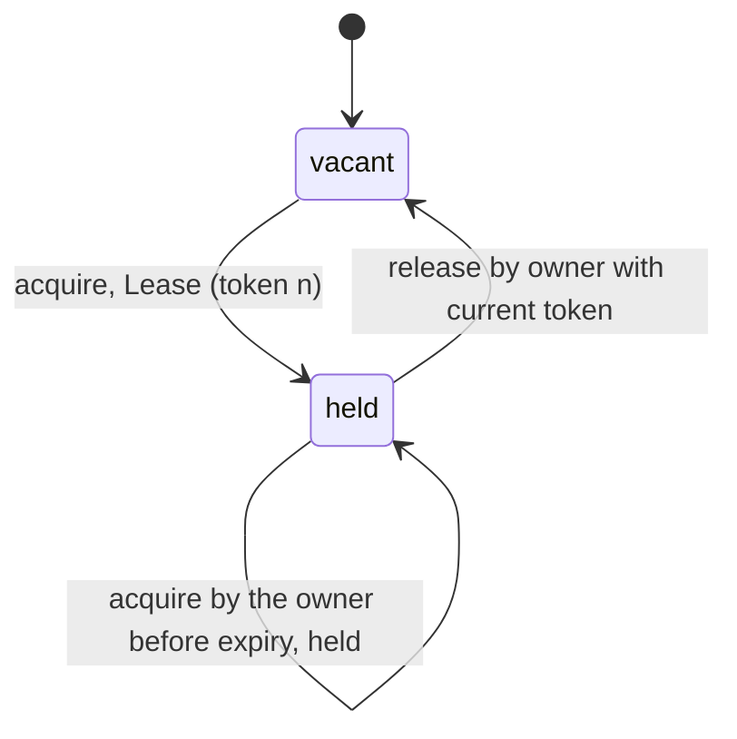

# LeaseMachines

> Expiry tells the next worker it may start. The fence tells the last one it must stop. 🔑

Time-limited ownership for Ruby. One `LeaseAuthority` decides who holds a resource and until when. Every grant comes with a token that only ever goes up. A `Fence` at the resource turns away any token older than the last one it saw. That's how a worker that fell asleep holding the key finds out, on waking, that it's no longer the captain.

## Quick Start

```bash
gem 'lease_machines'
```

```ruby
SECOND = 1_000_000_000
authority = LeaseMachines::LeaseAuthority.with_scope(7)

# owner, now, ttl
lease = authority.acquire(worker.id, clock.now, 30 * SECOND)
raise "refused: #{lease}" if lease.is_a?(Symbol)
lease.token   # => #<data LeaseMachines::FencingToken raw=1970324836974593>, token 1 of scope 7

# ... do the work, renewing before the ttl runs out ...
authority.renew(worker.id, lease.token, clock.now, 30 * SECOND)   # => Lease

# ... and hand it back when done.
authority.release(worker.id, lease.token, clock.now)              # => Lease
```

At the resource, keep a fence for the same scope and show it every token before you touch anything:

```ruby
fence = LeaseMachines::Fence.with_scope(7)

fence.accept(lease.token)   # => :advanced, first key seen
fence.accept(lease.token)   # => :current, same key, another write
fence.accept(newer.token)   # => :advanced, the next captain's key
fence.accept(lease.token)   # => :stale_token, that captain is retired
```

The Ruby API is the core's, name for name: `LeaseAuthority`, `Fence`, `Holder`, `FencingToken`, `Lease`, `Checkpoint` and `Cadence` are the core types, with the core's fields in the core's order, and arguments are positional in the core's order. Owners are Integers. Time is Integer nanoseconds on one monotonic clock, `Process.clock_gettime(Process::CLOCK_MONOTONIC, :nanosecond)`, for instants (`now`, `expires_at`) and spans (`ttl`) alike. No floats, no seconds, no `Time.now`.

## A Message to the Resistance

So you put a lock in Redis. `SET nightly_report_lock worker-7 NX EX 30`. One worker runs the report, the others back off, everyone goes home.

Then worker 7 hits a stop-the-world GC pause for forty seconds. The lock expires. Worker 12 takes it and starts writing the report. Worker 7 wakes up, has no idea anything happened, and finishes writing *its* report over the top of 12's.

The lock did its job. It expired on time. The problem is that expiry only tells the *next* owner it can start. It never tells the *old* owner it has to stop, because the old owner isn't listening. It's busy.

The only thing that works is a number. Every grant gets a bigger number than the last one, and the thing being protected refuses any number smaller than the biggest it has seen. Worker 7 shows up with token 1. The report store has already seen token 2. Door stays shut.

This gem is that number, and the authority that hands it out.

## Chapter 1: Stardate 2025.186, the AMS Cheriton

> **AMS Cheriton**, NCC-4211, *Cheriton*-class authority tender.
> An old captain's key must not open the engine room after a new command takes over.

The tender doesn't guard the engine room. It issues keys, each stamped with a higher serial than the last, each valid until a stated time. The engine room hatch keeps its own record of the highest serial it has ever accepted. A captain who went out of radio range and came back still holding serial 1 finds a hatch that has already seen serial 2.

Somewhere in the fleet, an ensign proposes:

```ruby
def run_nightly_report
  return unless redis.set("lock", id, nx: true, ex: 30)
  generate_report   # takes "about 20 seconds", usually
  redis.del("lock")
end
```

"That," says the quartermaster, "is how two captains end up writing the same log."

## The Flight Plan



And the night worker 7 fell asleep:


## How Authority Works

The examples below run in scope zero, where tokens read 1, 2, 3, and write `SECOND` for `1_000_000_000` nanoseconds.

### Acquire

```ruby
authority = LeaseMachines::LeaseAuthority.new

first = authority.acquire(1, 0, 2 * SECOND)   # owner, now, ttl
first.owner        # => 1
first.token.raw    # => 1
first.expires_at   # => 2_000_000_000
```

Every decision answers a `Lease` when it is honoured and a Symbol when it is not. The Symbol is the reason, and nothing changed.

```ruby
authority.acquire(2, 1 * SECOND, 2 * SECOND)   # => :occupied
```

Owner 2 asked at second 1. Owner 1's lease runs to second 2. Occupied. Ask again after it lapses and the answer changes:

```ruby
later = authority.acquire(2, 2 * SECOND, 2 * SECOND)
later.token.raw   # => 2
```

Token 2. Always newer. Never reused.

The owner of a live lease does not get it again by asking again:

```ruby
authority.acquire(2, 3 * SECOND, 2 * SECOND)   # => :held
```

That is not stubbornness. The authority cannot tell a retry from a second process using the same owner id, and handing both the same token is exactly the accident fencing exists to stop. The owner has two honest moves: `renew` with the token it holds, or `reacquire`.

### Reacquire

```ruby
rotated = authority.reacquire(2, 3 * SECOND, 2 * SECOND)
rotated.token.raw   # => 3
```

`reacquire` is `acquire`, except the current owner may trade its live lease for a new one under a new token. Token 2 is stale from that moment, so whatever was still working under it is fenced out. Another owner's live lease is still `:occupied`. Every honoured `reacquire` issues a token: call it twice and you rotate twice.

### Renew

The holder extends the lease by presenting its token. The new expiry is counted from `now`, not from the old expiry, and a renewal never shortens a lease.

```ruby
authority = LeaseMachines::LeaseAuthority.new
lease = authority.acquire(1, 0, 2 * SECOND)

renewed = authority.renew(1, lease.token, 1 * SECOND, 3 * SECOND)
renewed.expires_at   # => 4_000_000_000
```

Renew with the wrong owner, an old token, or a token this authority never issued, and you get a reason instead:

```ruby
authority.renew(2, lease.token, 1 * SECOND, SECOND)                              # => :wrong_owner
authority.renew(1, LeaseMachines::FencingToken.from_raw(2), 1 * SECOND, SECOND)  # => :unknown
```

### Release

```ruby
authority.release(1, lease.token, 2 * SECOND)   # => the Lease that was released
authority.release(1, lease.token, 2 * SECOND)   # => :no_lease
```

The second call is not answered "already released". The authority keeps no record of who released what, so it cannot prove that. `:no_lease` changes nothing either way.

Release at an instant when the lease has already lapsed and the authority tells you so:

```ruby
authority = LeaseMachines::LeaseAuthority.new
lease = authority.acquire(1, 0, 1 * SECOND)
authority.release(1, lease.token, 3 * SECOND)   # => :expired
```

### Time only moves forward

You supply `now`. The authority remembers the latest `now` of a call it *honoured* and refuses to go behind it.

```ruby
authority = LeaseMachines::LeaseAuthority.new
authority.acquire(1, 2 * SECOND, 1 * SECOND)
authority.acquire(2, 1 * SECOND, 1 * SECOND)   # => :clock_regressed
```

A refused call records nothing, its `now` included. Feed it a monotonic clock, not the wall clock. A `ttl` of zero is `:invalid_ttl`.

If your clock is one you cannot keep from stepping back, say so:

```ruby
authority = LeaseMachines::LeaseAuthority.new.with_clock_policy(:clamp)
authority.clock_policy   # => :clamp
```

Under `:clamp` a call that arrives with an earlier `now` is evaluated at the remembered instant instead of being refused. A backwards step therefore cannot undo anything an honoured call did: it cannot bring back a lease that was released or replaced, and it cannot shorten one. `:reject` is what a new authority starts with.

### `:expired` is about the instant you gave

Because a refusal records nothing, `:expired` is not a verdict the authority remembers. It answers one question: is this lease live at the `now` you supplied? Ask again with an earlier `now`, one that is not behind the latest *honoured* call, and the answer can be yes. Same under `:reject` and `:clamp`:

```ruby
authority = LeaseMachines::LeaseAuthority.new
lease = authority.acquire(1, 0, 10 * SECOND)

authority.renew(1, lease.token, 15 * SECOND, 10 * SECOND)   # => :expired, and nothing recorded
authority.renew(1, lease.token, 5 * SECOND, 10 * SECOND)    # => Lease, expires_at 15s
```

Second 5 is not a regression: the last honoured call was at second 0. So do not build anything on "it said `:expired`, therefore it is over". What is guaranteed:

- **One grant slot.** There is never more than one lease, and between those two calls it was owner 1's the whole time.
- **A new owner enters only through an honoured `acquire`** (or `reacquire`), which records its `now` and issues a newer token. From then on the old owner is `:wrong_owner` at any instant the authority still accepts, and its token is stale at the fence.
- **A `Holder` that was told.** A worker that hears `:expired`, calls `holder.expire`, and then receives a late "renewed" reply answers it `:expired`. Only `reacquire` with a strictly newer token brings it back.

```ruby
authority.acquire(2, 12 * SECOND, 10 * SECOND)              # => :occupied
authority.acquire(2, 15 * SECOND, 10 * SECOND).token.raw    # => 2
authority.renew(1, lease.token, 16 * SECOND, 10 * SECOND)   # => :wrong_owner
```

## The Fence

The authority decides who *should* have the resource. The fence is what the resource actually checks. Keep one next to the thing you're protecting, built for the scope of the authority that guards it, and call `accept` with the token before every mutation. `highest` tells you the high-water mark it's enforcing.

```ruby
fence = LeaseMachines::Fence.new   # scope zero; Fence.with_scope(7) for an authority in scope 7
fence.accept(later.token)          # => :advanced, write `fence.highest` down with the mutation
fence.accept(later.token)          # => :current, same lease, another write
fence.accept(first.token)          # => :stale_token
fence.highest                      # => later.token
```

A fence never learns its scope from the first token it sees. It is told, once, at construction, and a token of any other scope is `:unknown` no matter how large its number:

```ruby
stray = LeaseMachines::LeaseAuthority.with_scope(9).acquire(1, 0, SECOND).token
fence.accept(stray)   # => :unknown
```

Restarted the resource and remembered that mark? Start the fence from there:

```ruby
fence = LeaseMachines::Fence.resumed(0, LeaseMachines::FencingToken.from_raw(2))
fence.accept(LeaseMachines::FencingToken.from_raw(2))   # => :current, equal is fine
fence.accept(LeaseMachines::FencingToken.from_raw(1))   # => :stale_token
```

`resumed(scope, highest)` takes the scope from you, not from the saved token, and raises `RangeError` if the two disagree. Pass `nil` when nothing was accepted yet.

`accept` says nothing about expiry or authenticity. It only answers one question: have I seen a newer key than this one? That question is the whole point.

## The Holder

The worker's side of the conversation. A `Holder` tracks one grant on the worker's own clock: when to renew, when to start worrying, when to stop writing.

```ruby
cadence = LeaseMachines::Cadence.new(30 * SECOND, 10 * SECOND, 5 * SECOND)   # ttl, renew_after, warn_before
holder = LeaseMachines::Holder.new(lease.token, clock.now, cadence)          # token, confirmed_at, cadence

holder.renewal_due?(clock.now)   # => true, ten seconds after the last confirmation
holder.refresh(clock.now)        # => :started
renewed = authority.renew(worker.id, holder.token, clock.now, cadence.ttl)
holder.confirm(renewed.token, clock.now)   # => :recorded
holder.confirm(renewed.token, clock.now)   # => :duplicate, the reply arrived twice
```

`state` is one of `:confirmed`, `:unconfirmed`, `:at_risk`, `:expired`, `:fenced`. `at_risk?(now)` turns true once a renewal is outstanding or the warning deadline (`ttl - warn_before` after the last confirmation) has passed: stop taking new work. When the authority answers `:expired`, tell the holder and get a fresh grant:

```ruby
holder.expire                            # => :recorded
fresh = authority.acquire(worker.id, clock.now, cadence.ttl)
holder.reacquire(fresh.token, clock.now) # => :recorded, needs a strictly newer token
```

`holder.fence` is the end: it answers `nil`, cannot refuse, and every later report is `:fenced`. A holder follows the tokens of one scope, so a grant from an authority in another scope is `:unknown` to it; track that one with a new holder.

## Checkpoints

An authority can hand you a `Checkpoint` and later be rebuilt from it. It is four plain values: `scope`, `issued` (how many tokens this history has issued), the live `lease` or `nil`, and `observed` (the clock mark). Write them down before you act on a decision.

```ruby
authority = LeaseMachines::LeaseAuthority.with_scope(7)
authority.acquire(1, 0, 1 * SECOND)

saved = authority.checkpoint
saved.scope    # => 7
saved.issued   # => 1
row = [saved.scope, saved.issued, saved.observed,
       saved.lease && [saved.lease.owner, saved.lease.token.raw, saved.lease.expires_at]]

# ... the process restarts ...

lease = LeaseMachines::Lease.new(row[3][0], LeaseMachines::FencingToken.from_raw(row[3][1]), row[3][2])
checkpoint = LeaseMachines::Checkpoint.from_parts(row[0], row[1], lease, row[2])
restored = LeaseMachines::LeaseAuthority.restored(7, checkpoint, :reject)
restored.acquire(2, 1 * SECOND, 1 * SECOND).token   # => token 2 of scope 7, not token 1 again
```

`restored(scope, checkpoint, clock_policy)` takes the scope from you and raises `RangeError` for a checkpoint of another scope. It takes the clock policy too: that is configuration, not saved state, and it is never quietly reset. `Checkpoint.from_parts` raises `RangeError` for rows that cannot be one history: a lease that does not carry token number `issued` of that scope was either superseded or never granted here.

Stop the old authority before you start the one you restored. Two authorities for one resource is two captains.

### Every answer

A call that is honoured answers with a value. A call that is not honoured answers with one of the refusal symbols below, and only those, and changes nothing. Each refusal is the snake_case of one core `Refusal` variant; there is no catch-all symbol.

| Call | Honoured | Refusals | Records the clock |
| --- | --- | --- | --- |
| `authority.acquire(owner, now, ttl)` | `Lease` | `:clock_regressed`, `:invalid_ttl`, `:occupied`, `:held`, `:exhausted` | yes: the grant's expiry and the vacancy both depend on `now` |
| `authority.reacquire(owner, now, ttl)` | `Lease` (new token every time) | `:clock_regressed`, `:invalid_ttl`, `:occupied`, `:exhausted` | yes, like `acquire` |
| `authority.renew(owner, token, now, ttl)` | `Lease` | `:unknown`, `:clock_regressed`, `:no_lease`, `:wrong_owner`, `:stale_token`, `:expired`, `:invalid_ttl` | yes: honoured only while unexpired at `now`, a replay included |
| `authority.release(owner, token, now)` | `Lease` (the one released) | `:unknown`, `:clock_regressed`, `:no_lease`, `:wrong_owner`, `:stale_token`, `:expired` | yes: honoured only while unexpired at `now` |
| `fence.accept(token)` | `:advanced`, `:current` (equals the mark; nothing changed) | `:unknown`, `:stale_token` | no clock |
| `holder.refresh(now)` | `:started`, `:outstanding` | `:fenced` | no: a holder keeps no watermark; `now` only picks `:unconfirmed` or `:at_risk` |
| `holder.confirm(token, at)` | `:recorded`, `:duplicate` (already confirmed under `token`) | `:fenced`, `:unknown`, `:stale_token`, `:out_of_phase`, `:expired` | `:recorded` schedules the next renewal from `at`; `:duplicate` records nothing |
| `holder.expire` | `:recorded`, `:duplicate` (already expired) | `:fenced` | no clock |
| `holder.reacquire(token, at)` | `:recorded`, `:duplicate` (already confirmed under `token`) | `:fenced`, `:unknown`, `:stale_token`, `:out_of_phase` | `:recorded` schedules from `at`; `:duplicate` records nothing |

The authority records `now` (under `:clamp`, the instant it evaluated at) on every honoured call, because every honoured answer it gives depends on that instant; a refusal records nothing.

What each refusal means:

| Refusal | Meaning |
| --- | --- |
| `:occupied` | another owner's unexpired lease |
| `:held` | the owner's own unexpired lease: `renew` it or `reacquire` |
| `:no_lease` | nothing to renew or release |
| `:wrong_owner` | the owner is not the lease's |
| `:stale_token` | a token of this scope, older than the one in force |
| `:unknown` | a token of another scope, or one this authority never issued |
| `:expired` | the lease is expired at the instant supplied (authority: not remembered, see above), or the holder recorded `expire` |
| `:clock_regressed` | `now` is before the latest honoured call (never under `:clamp`) |
| `:invalid_ttl` | a zero `ttl`, or `now + ttl` out of range |
| `:exhausted` | all `2**48 - 1` tokens of the scope are issued |
| `:fenced` | the holder is fenced |
| `:out_of_phase` | the holder neither waits for that report nor recorded it |

`LeaseAuthority.new`, `LeaseAuthority.with_scope(scope)`, `with_clock_policy`, `clock_policy`, `scope`, `issued`, `checkpoint`, `Fence.new`, `Fence.with_scope(scope)`, `fence.scope`, `fence.highest`, `Holder.new`, `holder.state`, `holder.token`, `holder.cadence`, `holder.renewal_due?`, `holder.at_risk?`, `holder.warning_deadline` (`nil` once fenced) and `holder.fence` never refuse. `LeaseAuthority.restored`, `Fence.resumed`, `Checkpoint.from_parts`, `Cadence.new` and `FencingToken.from_raw` answer a value or raise `RangeError` for input the core's constructor answers `None` to.

A value is valid or does not exist. `FencingToken.new`, `Lease.new`, `Checkpoint.new` and `Cadence.new` are checked by the core whoever calls them, so a value built by hand is held to the rule one the gem answered is: `Lease.new('x', 5, -1)` raises `TypeError`, `Lease.new(1, token, -1)` raises `RangeError`. A `Lease` built with a sibling gem's token, or a `Checkpoint` with a sibling's lease, keeps this gem's own `FencingToken` and `Lease`, so it is `==` to the one the authority answers.

## The Rules of the Tender

- **Owners are Integers** in `0..2**64-1`. Floats raise `TypeError`, out-of-range raises `RangeError`.
- **Tokens are `FencingToken` values**, never bare Integers: a `raw` Integer whose top 16 bits are the issuing authority's scope, above a sequence number counted from 1. `FencingToken.from_raw` raises `RangeError` for a sequence number of zero. A token you rebuilt proves nothing by itself.
- **A sibling's value fits as it is.** Wherever a method takes a token, a lease or a checkpoint, it reads a sibling gem's value by its readers (`raw`; `owner`, `token`, `expires_at`; `scope`, `issued`, `lease`, `observed`). A token that came back from `ElectionMachines` or `HandoffMachines` goes straight into `fence.accept`, `authority.renew`, `authority.release` or a `Holder`, and its `raw` is checked exactly as `FencingToken.from_raw` checks it. Anything without the reader, a bare Integer included, raises `TypeError`. What a method answers is always this gem's own `FencingToken`, `Lease` or `Checkpoint`.
- **The binding is the authority on values.** `FencingToken`, `Lease`, `Checkpoint` and `Cadence` are sealed (no `allocate`, no subclass), but Ruby binds a subclass constant before `inherited` raises, `Data#initialize` can be bound directly and `Marshal.load` skips `initialize`. So the native side reads one of this gem's values only when it is exactly that class (a subclass raises `TypeError`, whatever it holds) and checks every field again as the core's constructor does: a forged value raises `TypeError` or `RangeError` and never reaches the authority, a fence or a holder.
- **Time is Integer nanoseconds.** `now`, `ttl`, `expires_at`, `observed`, `confirmed_at`, `at`, a `Cadence`. A Float or any other non-Integer raises `TypeError`; a negative value, or one past the core's range (`2**64` seconds), raises `RangeError`. `expires_at` is `now + ttl` exactly, so it can read back larger than `2**64-1`.
- **Values mirror the core.** `Lease`, `Checkpoint`, `Cadence` and `FencingToken` are `Data` with the core's fields in the core's order. Enums without fields are Symbols: `:reject` and `:clamp`, the five holder states, every answer of `accept`, `refresh`, `confirm`, `expire` and `reacquire`. No argument has a default the core lacks, and nothing is a keyword.
- **Scopes.** A token only means something to the authority that issued it. Sequence numbers count from 1, so two authorities hand out the same tokens, and a fence could not tell them apart. Give each authority its own scope: `LeaseAuthority.with_scope(scope)`, any Integer in `0..65_535` (a non-Integer raises `TypeError`, anything outside the range raises `RangeError`). `LeaseAuthority.new` is scope zero, where tokens read 1, 2, 3. `authority.scope`, `fence.scope` and `token.scope` read it back. A token of another scope is `:unknown` to the authority, to a fence and to a holder, whatever its number, and changes nothing. Nobody can pick a scope for you, and two authorities left in the same scope still mix up each other's tokens.
- **Tokens of two scopes have no order.** `FencingToken` has no `<` and no `<=>`. `order` answers `-1`, `0`, `1`, or `nil` across scopes; `newer_than?` answers `false` across scopes.
- **The binding never loses work.** Every argument is read and checked before the authority is asked anything. Building the answer runs Ruby (`Lease.new`, `FencingToken.new`), so the authority decides on a copy, the `Lease` is built, and the copy is kept only if the authority is still unfrozen (`FrozenError` otherwise) and unchanged (`RuntimeError` otherwise: something re-entered it while the answer was built). A call that raised changed nothing.
- **Refusals don't raise.** Every call that can refuse answers a value when honoured and one of `LeaseMachines::REFUSALS` otherwise. Only malformed input raises: `TypeError` for the wrong type, `RangeError` for a value the core does not accept (a clock policy other than `:reject` or `:clamp` included). Nothing raises `ArgumentError` except Ruby itself, for the wrong number of arguments.
- **A refusal changes nothing.** Not the lease, not the token count, not the clock. That includes `:expired` and `:clock_regressed`: each is an answer about the `now` supplied, not a recorded fact, and the same call at another instant may be honoured.
- **A repeat is not a refusal, when it can be proved.** `:duplicate` and `:current` mean "that was already true, nothing changed". Treat them as success. `acquire` and `release` have no such answer, for the reasons given where they are described.
- **Frozen means frozen.** `freeze` an authority, a fence or a holder and every mutating call raises `FrozenError`. Reads still work.

## What You Think You're Doing vs Reality

### You Think: "The lock has a TTL, so stale holders can't hurt anyone."
### Reality: A stale holder doesn't know it's stale.

Expiry frees the resource for the next owner. It does nothing to the previous one, who may be mid-write, paused, or partitioned, and will finish whatever it was doing the moment it can. The fence is what stops that write. Without it the TTL is a courtesy, not a guarantee.

## What's Yours

The authority is a decision engine, not a server. Run one per resource, write its `checkpoint` down before anyone acts on a decision, and feed it a clock that never runs backwards. Put the fence as close to the protected data as you can get it, ideally in the same transaction as the write, and write `fence.highest` down in that transaction too.

The authority lives in your process and forgets everything when the process does. A fresh one counts from 1 again, which hands token 1 to a new captain while the old token 1 is still out there. Either restore the newest checkpoint with `LeaseAuthority.restored(scope, checkpoint, clock_policy)`, or start the new incarnation in a scope no earlier one used and rebuild every fence for that scope. Restoring an older checkpoint than the newest is the same mistake as starting fresh: it reissues tokens, and nothing in the gem can notice.

Tokens are numbers, not signatures. Anyone can build a `FencingToken`. The authority knows which ones it issued and a fence knows which scope it serves, but neither can tell a real token from a well-guessed one. Authenticating whoever presents it is yours.

Owner ids are whatever you say they are. Two processes that present the same owner id are the same owner as far as the authority can tell, which is exactly why `acquire` answers `:held` instead of handing the live token out twice.

## License

MIT License. See [LICENSE.txt](LICENSE.txt) for details.

**Remember: Worker 7 is still out there, still holding token 1, still sure it's the captain.**
