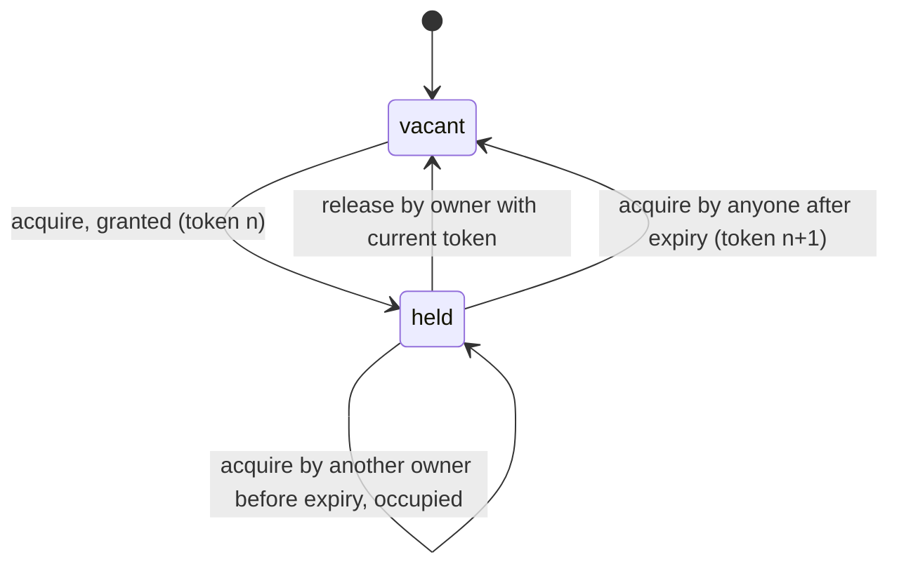
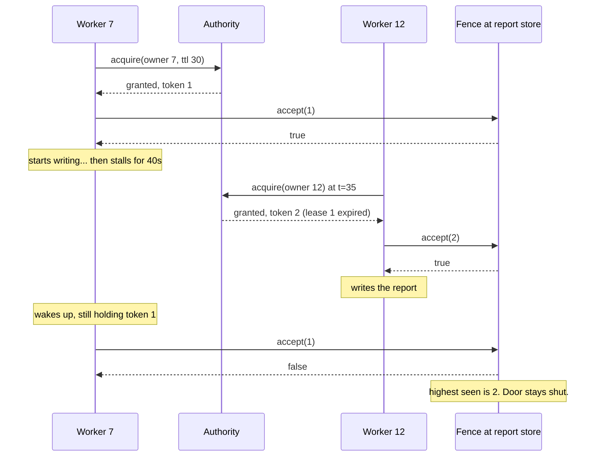

# LeaseMachines

> Expiry tells the next worker it may start. The fence tells the last one it must stop. 🔑

Time-limited ownership for Ruby. One `Authority` decides who holds a resource and until when. Every grant comes with a token that only ever goes up. A `Fence` at the resource turns away any token older than the last one it saw. That's how a worker that fell asleep holding the key finds out, on waking, that it's no longer the captain.

## Quick Start

```bash
gem 'lease_machines'
```

```ruby
authority = LeaseMachines::Authority.new

grant = authority.acquire(owner: worker.id, now: clock.now, ttl: 30.0)
grant.status        # => :granted
grant.lease.token   # => 1

# ... do the work, renewing before the ttl runs out ...
authority.renew(owner: worker.id, token: grant.lease.token, now: clock.now, ttl: 30.0)

# ... and hand it back when done.
authority.release(owner: worker.id, token: grant.lease.token, now: clock.now)
```

At the resource, keep a fence and show it every token before you touch anything:

```ruby
fence = LeaseMachines::Fence.new

fence.accept(1)  # => true, first key seen
fence.accept(2)  # => true, newer key
fence.accept(1)  # => false, that captain is retired
```

## A Message to the Resistance

So you put a lock in Redis. `SET nightly_report_lock worker-7 NX EX 30`. One worker runs the report, the others back off, everyone goes home.

Then worker 7 hits a stop-the-world GC pause for forty seconds. The lock expires. Worker 12 takes it and starts writing the report. Worker 7 wakes up, has no idea anything happened, and finishes writing *its* report over the top of 12's.

The lock did its job. It expired on time. The problem is that expiry only tells the *next* owner it can start. It never tells the *old* owner it has to stop, because the old owner isn't listening. It's busy.

The only thing that works is a number. Every grant gets a bigger number than the last one, and the thing being protected refuses any number smaller than the biggest it has seen. Worker 7 shows up with token 1. The report store has already seen token 2. Door stays shut.

This gem is that number, and the authority that hands it out.

## Chapter 1: Stardate 2025.186, the AMS Cheriton

> **AMS Cheriton**, NCC-4211, *Cheriton*-class authority tender.
> An old captain's key must not open the engine room after a new command takes over.

The tender doesn't guard the engine room. It issues keys, each stamped with a higher serial than the last, each valid until a stated time. The engine room hatch keeps its own record of the highest serial it has ever accepted. A captain who went out of radio range and came back still holding serial 1 finds a hatch that has already seen serial 2.

Somewhere in the fleet, an ensign proposes:

```ruby
def run_nightly_report
  return unless redis.set("lock", id, nx: true, ex: 30)
  generate_report   # takes "about 20 seconds", usually
  redis.del("lock")
end
```

"That," says the quartermaster, "is how two captains end up writing the same log."

## The Flight Plan



And the night worker 7 fell asleep:



## How Authority Works

### Acquire

```ruby
authority = LeaseMachines::Authority.new

first = authority.acquire(owner: 1, now: 0.0, ttl: 2.0)
first.status            # => :granted
first.lease.owner       # => 1
first.lease.token       # => 1
first.lease.expires_at  # => 2.0
```

Every call returns a `Decision` with `status`, `lease`, and `reason`. A grant has a lease and no reason. A rejection has a reason and no lease.

```ruby
authority.acquire(owner: 2, now: 1.0, ttl: 2.0).reason   # => :occupied
```

Owner 2 asked at second 1. Owner 1's lease runs to second 2. Occupied. Ask again after it lapses and the answer changes:

```ruby
later = authority.acquire(owner: 2, now: 2.0, ttl: 2.0)
later.status        # => :granted
later.lease.token   # => 2
```

Token 2. Always bigger. Never reused.

### Renew

The holder extends the lease by presenting its token. The new expiry is counted from `now`, not from the old expiry.

```ruby
authority = LeaseMachines::Authority.new
grant = authority.acquire(owner: 1, now: 0.0, ttl: 2.0)

renewed = authority.renew(owner: 1, token: 1, now: 1.0, ttl: 3.0)
renewed.status             # => :renewed
renewed.lease.expires_at   # => 4.0
```

Renew with a token the authority didn't issue, or with the wrong owner, and you get a reason instead:

```ruby
authority.renew(owner: 1, token: 2, now: 1.0, ttl: 1.0).reason   # => :stale_token
```

### Release

```ruby
authority.release(owner: 1, token: 1, now: 2.0).status   # => :released
```

Release after the lease already lapsed and the authority tells you so:

```ruby
authority = LeaseMachines::Authority.new
authority.acquire(owner: 1, now: 0.0, ttl: 1.0)
authority.release(owner: 1, token: 1, now: 3.0).reason   # => :expired
```

### Time only moves forward

You supply `now`. The authority remembers the latest `now` it has seen and refuses to go backwards.

```ruby
authority = LeaseMachines::Authority.new
authority.acquire(owner: 1, now: 2.0, ttl: 1.0)
authority.acquire(owner: 2, now: 1.0, ttl: 1.0).reason   # => :clock_regressed
```

Feed it a monotonic clock, not the wall clock. A `ttl` of zero is `:invalid_ttl`.

## The Fence

The authority decides who *should* have the resource. The fence is what the resource actually checks. Keep one next to the thing you're protecting and call `accept` with the token before every mutation. `highest` tells you the high-water mark it's enforcing.

Restarted the resource and remembered that mark? Start the fence from there:

```ruby
fence = LeaseMachines::Fence.new(highest: 2)
fence.accept(2)     # => true, equal is fine
fence.accept(1)     # => false
fence.highest       # => 2
```

`accept` says nothing about expiry or authenticity. It only answers one question: have I seen a newer key than this one? That question is the whole point.

## Checkpoints

An authority can hand you a `Checkpoint` and later be rebuilt from it. The rebuilt authority remembers the highest token it ever issued, so the serial numbers keep climbing across the restart.

```ruby
authority = LeaseMachines::Authority.new
authority.acquire(owner: 1, now: 0.0, ttl: 1.0)

checkpoint = authority.checkpoint
checkpoint.last_issued   # => 1

restored = LeaseMachines::Authority.restore(checkpoint)
restored.acquire(owner: 2, now: 1.0, ttl: 1.0).lease.token   # => 2
```

Stop the old authority before you start the one you restored. Two authorities for one resource is two captains.

## The Rules of the Tender

- **Owners and tokens are Integers** in `0..2**64-1`. Tokens start at 1. Floats raise `TypeError`, out-of-range raises `RangeError`.
- **Times are Floats** in seconds from a monotonic origin you choose. Negative, infinite, or NaN raise `ArgumentError`.
- **Rejections don't raise.** Wrong owner, stale token, expired lease, clock regression, bad ttl: all come back as a `Decision` with a `reason`. Only malformed input raises.
- **Frozen means frozen.** `freeze` an authority or a fence and every mutation raises `FrozenError`.

## What You Think You're Doing vs Reality

### You Think: "The lock has a TTL, so stale holders can't hurt anyone."
### Reality: A stale holder doesn't know it's stale.

Expiry frees the resource for the next owner. It does nothing to the previous one, who may be mid-write, paused, or partitioned, and will finish whatever it was doing the moment it can. The fence is what stops that write. Without it the TTL is a courtesy, not a guarantee.

## What's Yours

The authority is a decision engine, not a server. Run one per resource, make sure its decisions are written down before anyone acts on them, and feed it a clock that never runs backwards. Put the fence as close to the protected data as you can get it, ideally in the same transaction as the write.

## License

MIT License. See [LICENSE.txt](LICENSE.txt) for details.

**Remember: Worker 7 is still out there, still holding token 1, still sure it's the captain.**
